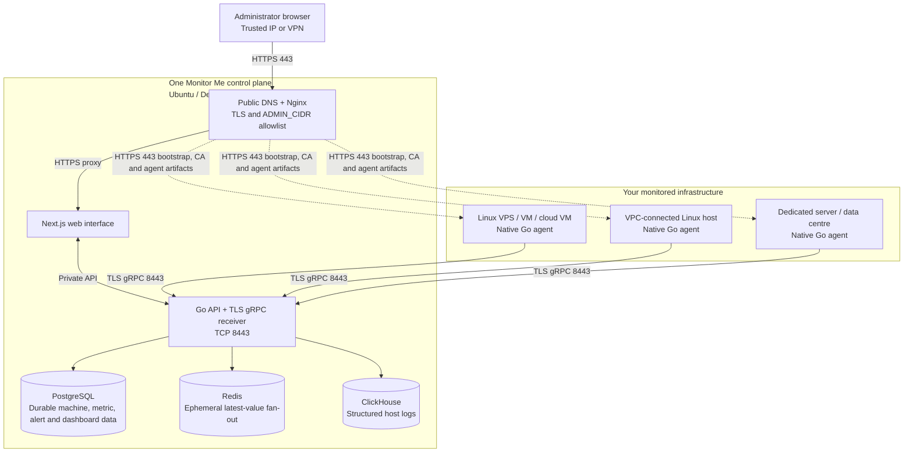

# Monitor Me

**Self-hosted infrastructure monitoring for the servers you own.**

Monitor Me brings server health, host metrics, system logs and threshold alerts into one installation that runs on infrastructure you control. Deploy one control plane on a supported Linux server, enrol the machines you want to monitor, and inspect their real telemetry from a browser.

<p align="center">
  
</p>

<p align="center">
  
  
  
</p>

## What it does

Monitor Me is designed for an individual operator or infrastructure team that wants visibility into VPS instances, virtual machines, cloud VMs, VPC-connected Linux machines and dedicated servers without sending monitoring data to a hosted monitoring service.

A single control-plane installation manages its own machine inventory and data. A small native agent runs on each monitored host. The agent collects host measurements and supported system logs, then sends them securely to the control plane. The web interface turns those stored measurements into fleet health, host detail, searchable logs, saved dashboards and alert events.

**Monitoring is read-only.** It observes hosts; it does not provide remote shell access or commands to stop processes, restart services or change host configuration.

## Features

| Area | What is available |
|---|---|
| **Monitoring** | Fleet cards for every enrolled machine, connected-first sorting, hostname, health state and heartbeat. Select a machine to open one scrollable detail view with CPU, per-core CPU, memory, swap, mounted-volume capacity, disk I/O, network, process count and recent host logs. Charts use stored host samples only. |
| **Servers** | Enrolment, machine inventory, agent connectivity, host metadata, detailed metrics and process/socket inventory. |
| **Logs** | Searchable Linux system journal events with time range, severity and source filters, event details and paginated results. |
| **Dashboards** | Build and save installation-local dashboards with metric and host-log panels. Available visualisations include time series, area, bar, stat, gauge, heatmap and table. Panels support editing, reordering and machine/time defaults. |
| **Alerts** | Metric-threshold rules with create, edit, pause, resume and delete actions. Firing and recovered events appear in the interface and on matching metric charts. |
| **Agent reliability** | Machine-scoped enrolment, TLS gRPC transport, bounded local write-ahead spool, retry with backoff and acknowledgement after durable backend acceptance. |

### Collected host data

On supported Linux hosts, the agent reports:

- CPU utilisation, per-core utilisation, user/system time and I/O wait.
- Physical memory, available memory, cache and swap.
- Mounted filesystem total, used, free and percentage, with mountpoint, device and filesystem labels.
- Disk read/write throughput and operations per second.
- Network receive/transmit throughput, packets and errors per second, per interface.
- Uptime, process count, selected process memory metadata and TCP connection/listening-port inventory.
- systemd journal events when the agent has permission to read the system journal.

Filesystem capacity is sampled approximately once per minute. A metric that is missing, unsupported or unreadable remains unavailable; Monitor Me does not replace it with a fabricated zero or demo value.

## Install the control plane

The public setup command is intended to run from this repository after the project has been uploaded to the account shown below.

```bash
git clone https://github.com/thesadiklaskar/monitor_me.git
cd monitor_me
sudo ./install.sh
```

The installer configures the control-plane host, installs Docker Engine and Compose when needed, installs the web reverse proxy and certificate renewal tooling, generates private database/cache secrets, configures the administrator network allowlist, obtains HTTPS, starts the application containers, runs SQL migrations and checks service readiness.

### Before running the command

Use a clean **Ubuntu or Debian x86-64 (amd64) Linux host** with:

1. Root/sudo access, systemd and working outbound internet access.
2. A DNS hostname with an A record pointing to the control-plane server's public IPv4 address.
3. Provider/network ingress rules ready for the ports below. Provider security groups and VPC firewall rules must be set in the provider console; the installer cannot change those without your cloud credentials.
4. The public IP or CIDR range from which the administrator will open the web interface.
5. An email address for HTTPS certificate registration and renewal notices.

The installer asks for the hostname, administrator CIDR and certificate email. It can suggest the SSH client's IP as the administrator CIDR. Keep that value accurate; the web interface has no application login.

### Network access

| Port | Direction | Source | Purpose |
|---|---|---|---|
| TCP 22 | Inbound | Administrator IP/CIDR only | SSH administration |
| TCP 80 | Inbound | Public internet | HTTPS certificate challenge and HTTP-to-HTTPS redirect |
| TCP 443 | Inbound | Public internet; the operator UI is restricted by the host allowlist | HTTPS UI and rate-limited agent installer/artifact/CA downloads |
| TCP 8443 | Inbound | Monitored host networks; can be restricted to a known agent CIDR | Agent telemetry over TLS gRPC |

The installer configures the host firewall when it is safe to do so and applies the Nginx administrator allowlist. It does not expose PostgreSQL, Redis, ClickHouse or the private API directly. Do not create public inbound rules for database ports 5432, 6379, 8123, 9000 or the internal API/web ports.

During a first install, the installer asks for an optional agent source CIDR. Enter the trusted VPC/subnet range when monitored machines connect from a known network; the value is saved as `AGENT_GRPC_CIDR` and used to restrict TCP 8443. Leave it blank when agents connect from changing or unrelated addresses; their machine-scoped TLS credentials are still required. Review existing host-firewall rules before changing an already deployed installation, because the firewall helper adds rules and does not remove earlier broad allow rules.

### Deploying on a VPS, VM, VPC or dedicated server

The hosting provider does not determine compatibility; the control-plane operating system and CPU architecture do.

| Environment | Deployment guidance |
|---|---|
| **VPS / public cloud VM** | Supported when the instance runs Ubuntu/Debian amd64, has the required DNS and network access, and meets the same prerequisites above. |
| **Cloud VM inside a VPC** | Supported when the VPC routes administrator HTTPS traffic and agent TCP 8443 traffic to the control plane, and the control plane can complete the public HTTPS certificate challenge. Configure the provider's security rules yourself. |
| **Private-only VPC with no public HTTP ingress** | Not supported by the current one-command installer. It uses an HTTP-based public certificate challenge and publishes HTTPS bootstrap routes for agents; private-CA and DNS-based certificate provisioning are not implemented. |
| **Dedicated server / own data centre** | Supported on Ubuntu/Debian amd64 with a routable DNS name, the same ports and a working outbound connection. |
| **Other cloud providers** | The same VM requirements apply. No provider-specific account, IAM or VPC API integration is required or configured by Monitor Me. |

A load balancer can be used only when it forwards the required traffic correctly. Port 80 must reach the host's certificate-challenge endpoint, HTTPS must preserve the administrator source address used by the allowlist, and TCP 8443 must pass the agent's TLS gRPC connection to the control plane. The current Nginx setup does not consume proxy-supplied client IP headers as a trusted identity source.


### Cloud-provider examples

The same operating-system and network requirements apply on both platforms:

- **AWS:** create an x86-64 Ubuntu/Debian VM in your VPC. Attach a public IPv4 address or a correctly routed public HTTPS endpoint, point the DNS A record at it, and configure the VM's security group for SSH from the administrator CIDR, TCP 80/443 for the public certificate and HTTPS endpoints, and TCP 8443 from the monitored-agent networks. Use a dedicated agent CIDR when the VPC layout has stable source ranges.
- **Google Cloud:** create an x86-64 Ubuntu/Debian VM in the selected VPC. Point the DNS A record at its reachable public IPv4 endpoint and add targeted VPC firewall ingress rules for SSH from the administrator CIDR, TCP 80/443, and TCP 8443 from the monitored-agent networks. Keep database and internal application ports private.

For either provider, the one-command installer configures the guest operating system; it does not create the VM, reserve addresses, edit cloud firewall rules, configure IAM, or create DNS records. Perform those infrastructure steps in your own cloud account before running the installer.

**Not every Linux image or machine architecture is currently a supported control-plane target.** The automated installer is Ubuntu/Debian amd64 only. It does not install the control plane natively on Windows, macOS, BSD, Alpine/OpenRC or ARM64 hosts.

## Enrol monitored machines

1. Open the HTTPS address printed by the installer from the administrator network.
2. In **Servers**, choose **Add machine**.
3. Select the target operating system and copy its generated enrolment command.
4. Run the command on the target host with administrator/root privileges.
5. Return to **Monitoring** and confirm that the machine is connected and real samples are appearing.

The Linux agent is a native service; Docker is not required on monitored machines. It downloads the matching agent artifact and CA over HTTPS, checks the artifact checksum, enrols with a short-lived one-use token and sends telemetry to TCP 8443. Monitored machines need outbound HTTPS and outbound TLS gRPC; they do not need an inbound Monitor Me port.

The supported Linux agent target is a systemd-based Linux host with readable procfs and journal permissions. Linux amd64 is the primary target; Linux arm64/aarch64 builds exist but require real hardware runtime acceptance before being treated as certified. Windows x64 service and collection code is present but still requires end-to-end runtime acceptance. macOS, Windows ARM64 and BSD are not released agent targets.

## System design

The deployment is the same whether the control plane is hosted on a VPS, a cloud VM, a VPC-routed VM, a dedicated machine or in your own data centre. Install one control plane on the supported Linux host; install agents on the machines to monitor.



### Telemetry flow

1. The agent reads host counters and supported operating-system logs.
2. Unacknowledged telemetry is placed in a bounded local write-ahead spool.
3. The agent sends authenticated batches over TLS gRPC on TCP 8443.
4. The Go API validates the machine credential, bounds and stores the data, and acknowledges only after durable acceptance.
5. PostgreSQL stores metric history and installation state. Redis carries ephemeral latest-value notifications; it is not the durable source of truth. ClickHouse stores structured host log events.
6. The web interface requests bounded metric ranges and log pages from the private API through same-origin routes. Live updates use bounded WebSocket delivery; the Monitoring detail view refreshes its summary, charts and logs periodically.

An editable system-design canvas is available in [monitor-me-architecture.excalidraw](docs/monitor-me-architecture.excalidraw). Download it and import the file into [Excalidraw](https://excalidraw.com/) to inspect or modify the diagram.

## Technology and components

| Layer | Technology | Responsibility |
|---|---|---|
| Web | Next.js 16, React 19, TypeScript | Operator UI, same-origin API proxy routes, fleet view, log explorer and saved dashboards |
| API | Go 1.27.4, HTTP and gRPC, Protocol Buffers | Machine enrolment, authenticated ingestion, queries, alert rules and migrations |
| Agent | Go 1.27.4 | Native Linux host collection, journald reader, bounded spool and TLS telemetry delivery |
| Durable metrics and state | PostgreSQL 18.7 | Machines, credentials, metric history, dashboard and alert state |
| Live fan-out | Redis 8.10.3 | Ephemeral latest-value cache/pub-sub |
| Logs | ClickHouse 26.8.44.3 | Structured host log storage and time-bounded search |
| Production runtime | Docker Compose v2 | Isolated control-plane services and persistent data volumes |
| Edge and certificates | Nginx, TLS 1.2/1.3, automated certificate renewal | HTTPS termination, request routing and administrator source allowlist |
| Host security | UFW or firewalld | Host ingress rules; cloud/VPC firewall rules remain provider-managed |

Monitor Me includes its own operator interface, query APIs and visualisation components. No external monitoring dashboard or metrics service is required.

## Security and data boundaries

- The browser interface has **no application login**. Access is restricted by Nginx to the configured administrator CIDR. Use a trusted static address or VPN and never allow the whole internet to access the operator UI.
- Agent telemetry uses TLS gRPC and machine-scoped credentials. Initial enrolment uses a short-lived, one-use token; the downloaded artifact checksum is verified.
- HTTPS certificates are renewed automatically. The gRPC service reads the restricted certificate copy managed by the installer.
- Database/cache secrets are randomly generated and stored in the root-only `.env.production` file (mode 0600). Do not upload that file or the certificate directory to source control.
- PostgreSQL, Redis and ClickHouse stay on the private Compose network. Public provider rules should expose only the required ingress ports.
- Agents are monitoring-only. The product does not offer remote command execution or process/service control.

## Logs and operations

**Host logs in the UI:** Linux journald events collected by the enrolled agent and searched from **Logs** or the selected machine's Monitoring view. The available event details include timestamp, severity, source and message body.

General file tailing for arbitrary `/var/log` files, generic syslog-file ingestion and log rotation tracking are not implemented. Windows Event Log collection is not yet runtime-certified.

**Control-plane container logs:**

```bash
docker compose --env-file .env.production -f deploy/production/compose.yml ps
docker compose --env-file .env.production -f deploy/production/compose.yml logs --tail=100 api web migrate postgres redis clickhouse
```

**Readiness checks on the control-plane host:**

```bash
curl -fsS http://127.0.0.1:18080/health/ready
curl -fsS http://127.0.0.1:13000/api/config
```

Persistent application data is held in named Compose volumes. PostgreSQL backup and restore scripts are provided under `deploy/production/`. A complete ClickHouse log backup/restore workflow and automated application upgrade workflow are not yet provided; do not treat the PostgreSQL backup alone as a full installation backup.

## Current scope

- The production bootstrap target is Ubuntu/Debian amd64; clean-host certification across every supported release and provider is still required.
- No certified minimum CPU/RAM sizing, maximum fleet size or load limit has been published. Size the control-plane host from the number of enrolled machines, sampling volume, log volume and retention requirements, then load-test before production expansion.
- External email/chat alert delivery, arbitrary file-log tailing, private-CA/DNS-based installer certificate provisioning, fully private VPC installation and automated upgrades are not implemented.
- ARM64 Linux agent runtime, Windows x64 service/runtime and full log-store backup/restore need acceptance before being described as production-certified.

For frontend, API and agent implementation notes, see [web/README.md](web/README.md), [backend/README.md](backend/README.md) and [agent/README.md](agent/README.md).
